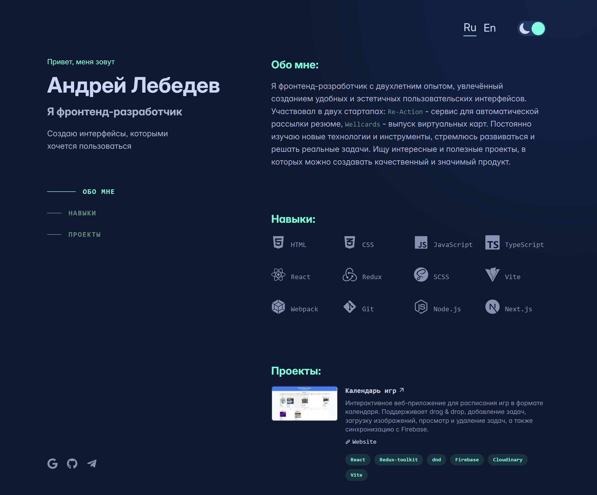

# 💼 Personal Portfolio Website

Современный одностраничный сайт-портфолио фронтенд-разработчика на **Next.js, React и TypeScript**.



## Особенности

- Next.js App Router и React 19
- TypeScript, SCSS-модули и CSS-переменные
- Переключение темы через Redux Toolkit
- Локализация на базе i18next
- Фиксированная левая колонка с навигацией и соцсетями
- Эффект свечения вокруг курсора
- Адаптивный дизайн

## Установка и запуск

```bash
yarn install
yarn dev
```

Откройте http://localhost:3000.

## Проверки и production

```bash
yarn lint
yarn typecheck
yarn build
yarn start
```
